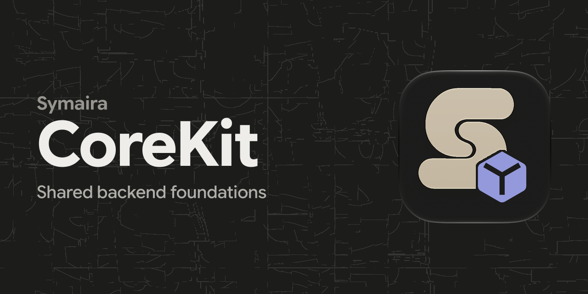

# Symaira CoreKit

> **Accepted product direction — implementation pending:** CoreKit is the single shared-library repository: Rust crates for the backends and, since v0.20.0, the Swift AppKit package for the native clients ([ADR 0006](docs/adr/0006-appkit-merged-into-corekit.md)). Product consolidation does not move credential cryptography, browser engines, native automation or product-domain policy into shared libraries. Shared modules require real consumers and immutable, tested contracts. See [PB-2026-09-09](docs/product-boundaries.md).

[](https://github.com/danieljustus/symaira-corekit/actions/workflows/ci.yml)
[](https://github.com/danieljustus/symaira-corekit/releases)
[](LICENSE)



> Shared Rust crates for the Symaira backends and the shared Swift package
> (AppKit, under [`swift/`](swift/README.md)) for the native clients. The Go library was retired from
> `main` after **v0.18.3**, the final Go release; Go consumers keep that exact pin
> ([ADR 0005](docs/adr/0005-go-library-retirement.md)).

**Status:** pre-1.0 — see [CHANGELOG.md](CHANGELOG.md).

Bundles domain-free infrastructure that is otherwise duplicated across tools:
MCP stdio server, MCP client-config discovery, TOML config loading, exit codes,
logging, path safety, secret references, SQLite setup, LLM provider transport
and update checking/applying.

## Why CoreKit

- **Standalone-first:** every crate works without any other Symaira tool installed — optional integrations are runtime contracts, never build-time imports.
- **Cross-language conventions:** exit codes, XDG paths, env-var naming and MCP stdio framing are shared contracts that also guide the Swift and Python tools ([`docs/cross-language-conventions.md`](docs/cross-language-conventions.md), fixtures in [`contracts/`](contracts/README.md)).
- **Exact pins:** consumers depend on a full 40-character Git revision plus `Cargo.lock` ([ADR 0002](docs/adr/0002-rust-distribution-git-pins.md)); crates stay `publish = false`.
- **Domain-free:** no Vault crypto, Memory PII rules, Seek ranking, Fetch fingerprinting, Scope scanning, or cloud/SaaS primitives.

## Platform support

Product scope is Apple platforms (Apple Silicon macOS and iOS) plus Web.
Linux remains supported for backend/server and CLI consumers where applicable.
CoreKit is a shared backend library, not an iOS or Web application runtime.

| Target | CoreKit verification |
| --- | --- |
| macOS arm64 | Native Rust workspace, frozen Go-free contracts, port contracts on PRs and `main` |
| Linux amd64 | Native Rust workspace and the same applicable acceptance gates |
| macOS / iOS (Swift package) | `swift.yml`: build, tests, format, README examples on macOS; iOS Simulator build on `main` |
| Web | Product integration scope; no dedicated CoreKit CI lane |
| Windows / macOS Intel | Unsupported; no CI or release targets |

## Install

**Swift (AppKit):** add the package as an exact-pinned SwiftPM dependency and
reference products with `package: "symaira-corekit"`; see
[`swift/README.md`](swift/README.md).

```swift
.package(url: "https://github.com/danieljustus/symaira-corekit.git", exact: "0.22.2")
```

**Rust:** pin an exact revision in the consumer's `Cargo.toml` and commit `Cargo.lock`:

```toml
[dependencies]
symaira-core-log = { git = "https://github.com/danieljustus/symaira-corekit", rev = "<40-hex revision>" }
```

## Crates

| Crate | Purpose |
|-------|---------|
| `symaira-core-exit` | Typed exit codes and CLI error mapping; see [`contracts/exit_codes.json`](contracts/exit_codes.json) |
| `symaira-core-version` | `version --json` handshake payload (`{tool, version, schema_version}`) |
| `symaira-core-env` | Ordered environment-variable lookup helpers |
| `symaira-core-log` | Structured stderr logging, configured via `SYM<APP>_LOG_LEVEL` |
| `symaira-core-config` | TOML config loader with XDG paths, project overrides and env vars |
| `symaira-core-fs` | Capability-scoped filesystem primitives: atomic writes, path validation, temp-file safety |
| `symaira-core-secretref` | Secret references: `symvault://`, `keychain://`, `env://`, bare env names |
| `symaira-core-mcp` | Small, owned MCP JSON-RPC 2.0 stdio adapter with zero stdout pollution |
| `symaira-core-mcpcfg` | MCP server config discovery across AI clients (JSONC/JSON/YAML) |
| `symaira-core-llm` | Descriptor-driven LLM providers (OpenAI-compatible, Anthropic, Ollama), streaming, embeddings, error taxonomy |
| `symaira-core-sqlite` | SQLite open/pragma/migration/locking contract |
| `symaira-core-update` | Release check, archive extraction, checksum/Cosign verification, atomic apply with rollback |

## Swift package (AppKit)

The Swift package formerly developed as `symaira-appkit` lives under
[`swift/`](swift/README.md): `SymairaTheme`, `SymairaCLIRunner`,
`SymairaToolKit`, `SymairaKeychain`, `SymairaUpdateCheck`, `SymairaDaemonKit`,
`SymairaIngestContract`, `SymairaMCP` and `SymairaProviderKit`, plus the shared
GUI rules ([`swift/GUIDELINES.md`](swift/GUIDELINES.md),
[`swift/DESIGN.md`](swift/DESIGN.md)). Its contract tests read the same
`contracts/` fixtures as the Rust crates.

The former Go-only packages `auditkit`, `evidencekit`, `domkit`,
`vectorkit/turboquant` and `ollamakit` have no shared Rust crate: their
contracts are consumer-local (see [`docs/rust-port/demand-assessment.md`](docs/rust-port/demand-assessment.md)).
They remain available in Go at `v0.18.x`.

## Build and test

```sh
make build              # cargo build --workspace --all-targets --locked
make test               # cargo test --workspace --all-features --locked
make lint               # cargo fmt --check + clippy -D warnings
make rust-contracts     # complete Go-free native contract aggregate
make rust-hardening     # nextest, doctests, cargo-hack, coverage, audit, deny
make swift-test         # Swift package build + tests (needs a full Xcode)
make swift-lint         # swift-format --strict over swift/Sources and swift/Tests
```

No Go toolchain is required for any gate on `main`. The Swift targets resolve
a full Xcode toolchain themselves (see [`swift/README.md`](swift/README.md)).

## Documentation

- [`docs/cross-language-conventions.md`](docs/cross-language-conventions.md) — shared contracts that apply across Rust, Swift and Python tools
- [`docs/migrations.md`](docs/migrations.md) — migration notes per release
- [`docs/rust-port/README.md`](docs/rust-port/README.md) — contract-first Go→Rust migration record and gates
- [`docs/adr/`](docs/adr/) — architecture decision records
- [`assets/branding/README.md`](assets/branding/README.md) — vendored CoreKit brand-only icon family and checksum guard

## Versioning

Rust consumers pin an exact Git revision; Swift consumers pin an exact tag
(`exact: "0.22.2"`, SwiftPM accepts the `v` prefix). Repository tags after
`v0.18.3` on `main` describe the Rust workspace and, from `v0.20.0`, the Swift
package; Go consumers stay on `v0.18.x`.

Run `make consumer-drift` (or `scripts/consumer-drift.sh`) from this repo to run
the consumer verifier and list the CoreKit Go pin of every sibling Symaira repo.

## Contributing · Security · License

- [CONTRIBUTING.md](CONTRIBUTING.md) — contribution workflow
- [SECURITY.md](.github/SECURITY.md) — security reporting policy
- [AGENTS.md](AGENTS.md) — repository rules for contributors and agents

Licensed under the Apache-2.0 license. See [LICENSE](LICENSE).
